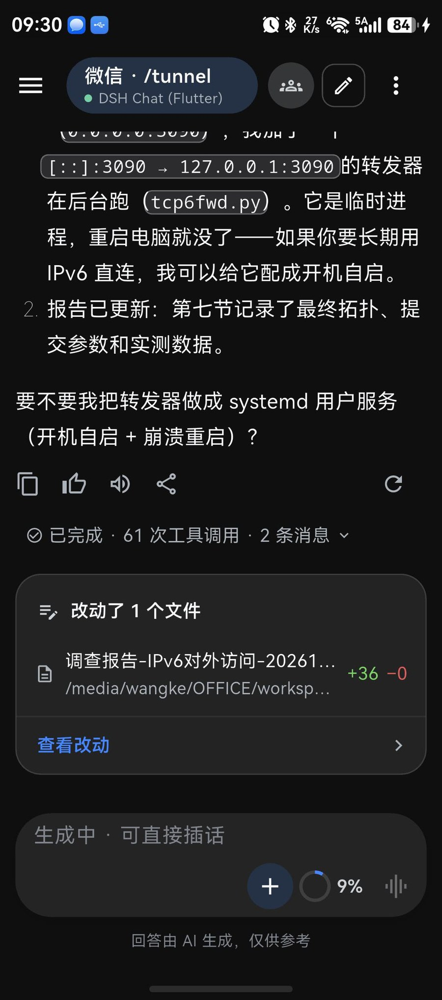
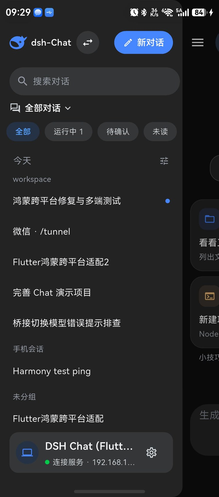
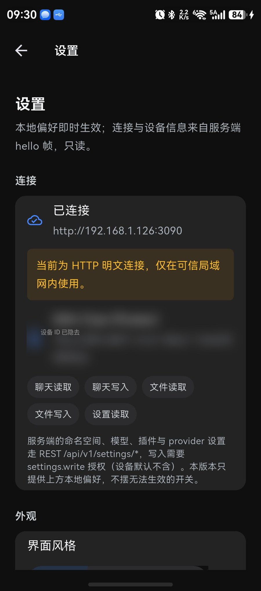

# dsh-Chat

<p align="center">
  <strong>The DSH chat client on your phone — one Flutter codebase for Android, iOS and HarmonyOS.</strong><br>
  Connect to your own <a href="https://github.com/westanke/dsh-remote-bridge">dsh-remote-bridge</a>;
  chats, sessions and tool calls stay on your machine.
</p>

<p align="center">
  
</p>

<p align="center">
  <a href="https://gitee.com/westanke/dsh-Chat/releases/tag/v1.0.36"><code>Download v1.0.36 · APK / HAP</code></a>
</p>

<p align="center">
  <a href="./README.md">中文</a> ·
  
  
  
  
  <a href="https://github.com/westanke/dsh-Chat/actions/workflows/ci.yml"></a>
</p>

`dsh-Chat` is the Flutter client for [`dsh-remote-bridge`](https://github.com/westanke/dsh-remote-bridge).
It reads sessions and history over REST `/api/v1` and receives streaming deltas over WS `/ws/mobile`
(subprotocol `dsh-mobile-v1`, `hello.protocol=3`). This repository only consumes the protocol; the
source of truth lives in the bridge repository's `docs/api/`.

**Who it is for**: people who use DSH as their main tool but do not want to be tied to the desk.
The phone is a display and input surface; chats, workspace and files stay on your own machine. The
bridge listens on loopback by default, so installing a client does not expose the machine by itself.

**Boundary**: this is not a fork of any official client. It does not connect to official servers and
does not reuse their icons, fonts or binaries. Visual measurements follow the official app (see
[`docs/design-tokens.md`](docs/design-tokens.md)), but all branding — launch mark, display name,
bundle id — belongs to this project.

## What it looks like

<p align="center">
  <a href="assets/screenshots/chat.jpg"></a>
  <a href="assets/screenshots/sessions.jpg"></a>
  <a href="assets/screenshots/settings.jpg"></a>
</p>

Left: chat, with Markdown, tool calls, process groups and a “changed N files” card on one timeline.
Middle: the session drawer, with search, date groups, running/waiting/unread filters and the current bridge.
Right: settings, with connection state, device permissions, appearance and notifications; the device id is redacted.

> Screenshots taken on HarmonyOS hardware (API 26). Android and HarmonyOS share the same Flutter UI;
> iOS has the native bridge but has not gone through on-device visual verification yet.

## Features

- **Streaming chat**: renders `chat.message.delta`, reloads history after `committed`, and debounces
  external REST writes.
- **Markdown**: headings, nested lists, task lists, fenced code (Atom One Light, language label,
  copy), full-width tables, quotes, inline/block math and link badges.
- **Tool calls**: official-style three-part titles, parameter summaries, five states kept in
  accessibility text, exit-code badges, and per-tool detail views (Bash command + IO, diffs, read
  windows, search hits, web results, question cards), driven by live frames.
- **Process groups**: consecutive calls collapse into one header with live parameters; four detail
  levels; a turn-end line with duration or failure.
- **Thinking stream**: breathing dot ring, shimmer label and a three-line live window; collapses to a
  one-line summary when the answer starts, expands to Markdown on tap.
- **Changed / generated files**: per-file `+N −M` diffs and generated-file thumbnails at the end of a
  turn, derived locally from `meta.diffs`.
- **Composer**: up to six images, `@` references to workspace files and past sessions, `/` commands,
  a persistent task strip, and per-session drafts that survive session switching.
- **Visible waiting and retries**: typing dots before the first token; an expandable
  “retried model request (1/5)” row when the kernel retries after 504/rate limiting.
- **Device capabilities**: local notifications (done / failed / waiting for approval / waiting for an
  answer), TTS, system sharing, photo picker, file opening and a private app directory. Android also
  supports in-app download/install; iOS and HarmonyOS update through their stores.
- **Dark mode, drawer, failures and reconnects**: system-following palettes, instant search and date
  groups, visible `turn/end` errors, and backoff 1→2→4→8→16s capped at 30s.

## Platform support

| Platform | Status |
|---|---|
| **Android** | **Verified on Android hardware**: pairing, auto-reconnect, streaming, Markdown, tool details, process groups, thinking, question cards, drawer, dark mode and sharing. v1.0.36 APK is 26.6 MB |
| **iOS** | Native bridge covers IANA time zone, private directory, notifications, TTS, sharing, image picker and file opening. CI builds an unsigned IPA. **Not verified on an iPhone**; updates go through the App Store |
| **HarmonyOS** | **Flutter-OH build verified on HarmonyOS hardware / API 26**: pairing, chat, sessions, sharing, TTS, picker and notifications (including tap-to-return) passed. Release distribution needs an AGC certificate/profile |
| Old ArkTS build | In `harmony/`, frozen and being retired |

Current version: `app/pubspec.yaml` is `1.0.36+37`, tag `v1.0.36`.

## Download and install

Latest **v1.0.36** (Gitee primary; GitHub mirrors the same tag):

| Artifact | Size | SHA-256 |
|---|---|---|
| [APK](https://gitee.com/westanke/dsh-Chat/releases/download/v1.0.36/dsh-Chat-v1.0.36.apk) | 26,615,566 bytes | `f91c7d37069abb12335a53f52d0f24eb697a8e29859c153b0973513a02369cd1` |
| [HAP](https://gitee.com/westanke/dsh-Chat/releases/download/v1.0.36/dsh-Chat-v1.0.36-harmony.hap) | 34,553,311 bytes | `2576f8b8da9c34a47d047063d28cb5ca75c346a13dd023ecf02e38663a6f754e` (project release certificate) |

- Android: install the APK directly. Some Android builds show a risk-interception page; confirm and continue.
- HarmonyOS: the HAP must be signed by a certificate the device trusts. For development use
  `scripts/sign-hap.sh`; for distribution use an AGC certificate and profile.
- iOS: no App Store build yet. Build an unsigned IPA from source on macOS or in GitHub Actions.

## First connection

1. Install and enable [`dsh-remote-bridge`](https://github.com/westanke/dsh-remote-bridge)
   (requires **≥ 2.10.0**, protocol v3) on the desktop, then open **Phone settings → Remote access**.
2. On the phone, open dsh-Chat and enter the bridge URL, e.g. `http://<host>:3090`
   (IPv6: `http://[<IPv6>]:3090`). On Android you can also run
   `adb reverse tcp:3090 tcp:3090` and use `http://127.0.0.1:3090`.
3. Paste the one-time pairing code and tap **Pair and connect**. Credentials are stored locally and
   the app reconnects automatically afterwards.

## Build from source

You need Flutter-OH `3.50.0+ohos-1.3.3`, the Android SDK and JDK 17; building the HarmonyOS HAP also
needs HarmonyOS SDK API 26. The SDKs are not bundled in this repository.

```sh
cd app
flutter pub get
flutter analyze
flutter test                # 590 cases

flutter build apk --release --target-platform android-arm64
flutter build hap --release --no-codesign
```

- Use **Flutter-OH**. Upstream stable lacks `TargetPlatform.ohos`, so the material_ui/cupertino_ui
  ohos forks do not compile.
- iOS on macOS: `flutter build ios --release --no-codesign`, then zip `Runner.app/Payload` into an
  unsigned IPA. The CI `macos-15` job already does this.

## CI and release

| Workflow | What it does |
|---|---|
| [`ci.yml`](.github/workflows/ci.yml) | `docs-check` + `flutter analyze` + `flutter test` (590) + legacy `harmony/test` `npm test`; uses the Flutter-OH SDK |
| [`release.yml`](.github/workflows/release.yml) | On a tag: Ubuntu builds the APK, `macos-15` builds an unsigned IPA; HAP is an optional self-hosted job (`BUILD_HAP=true` plus a real HarmonyOS SDK) |
| [`mirror-sync.yml`](.github/workflows/mirror-sync.yml) | Gitee → GitHub mirror; GitHub is a read-only mirror, day-to-day pushes go to Gitee |

`scripts/release.sh` runs the gates, builds the APK/HAP, optionally signs the HAP, backfills the
README, creates the two-site releases and verifies the uploaded assets. See
[`docs/project/RELEASE.md`](docs/project/RELEASE.md).

## Repository layout

```
dsh-Chat/
  AGENTS.md     ← engineering rules: red lines, commands, protocol discipline, doc sync, pitfalls
  assets/       ← README hero and actual-effect screenshots
  docs/         ← STRUCTURE.md / design-tokens.md / project/ (documentation index)
  ref/          ← official visual references and packet captures; read-only, not built or imported
  app/          ← Flutter project (lib/ has only design/, bridge/, ui/)
  app/ohos/     ← Flutter-OH HarmonyOS host project (bundleName com.dsh.dshchat)
  app/vendor/   ← patched third-party packages (gpt_markdown, see README.dsh.md)
  harmony/      ← old ArkTS HarmonyOS build (frozen, being retired)
  LICENSE       ← AGPL-3.0
```

## Known limitations

- **iOS is not device-verified**: the bridge is implemented and CI builds, but notification taps,
  TTS quality and photo/file permissions still need an iPhone. iOS does not allow in-app installs;
  updates point to the App Store.
- **HarmonyOS release signing**: a release HAP signed with the project certificate can fail with
  `signature verification failed due to not trusted app source` on some devices. Distribution needs
  an AGC certificate/profile.
- **App label**: the published v1.0.36 HAP still shows `dshchat` on the launcher; the source now says
  `DSH Chat` and the next build will carry it.
- **Toolchain is pinned**: all three platforms share the Flutter-OH SDK; replacing it with upstream
  stable breaks the ohos forks.
- **Updates**: only Android supports in-app download/install; iOS and HarmonyOS use their stores.

## Repositories

| Site | URL | Role |
|---|---|---|
| Gitee | <https://gitee.com/westanke/dsh-Chat> | Primary |
| AtomGit | <https://atomgit.com/westanke163/dsh-Chat> | Backup |
| GitHub | <https://github.com/westanke/dsh-Chat> | Automatic mirror; do not push by hand |

## Sibling projects

- [`dsh-remote-bridge`](https://github.com/westanke/dsh-remote-bridge) — the upstream desktop plugin
  (REST + WS + phone settings); its protocol and minimum version are authoritative (≥ 2.10.0, protocol v3).
- [`dsh-companion`](https://github.com/westanke/dsh-companion) — the Kotlin/Compose client in the same
  ecosystem, sharing the same bridge protocol. **No longer maintained or updated**; kept for historical
  reference only.

## License

[GNU Affero General Public License v3.0](LICENSE).
