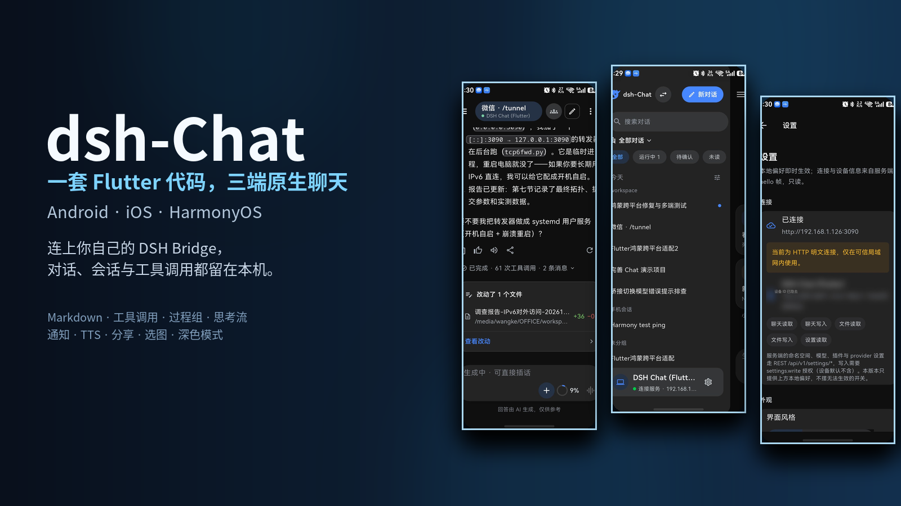
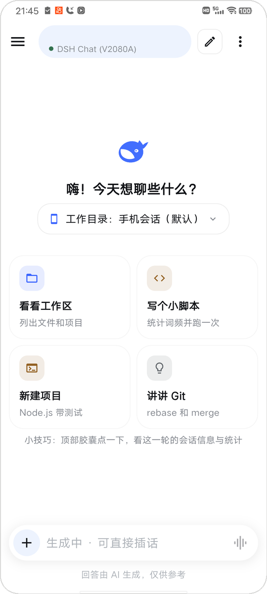
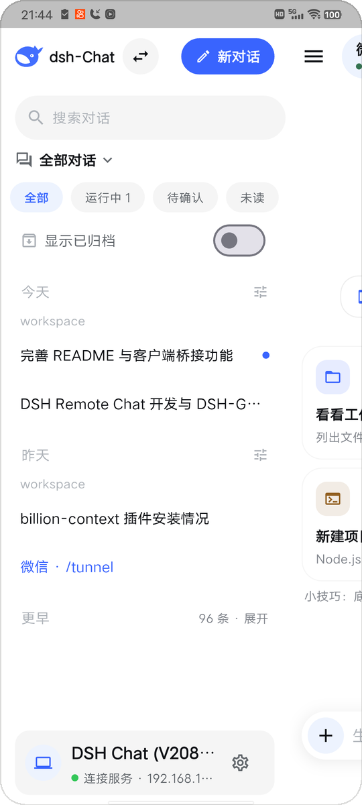
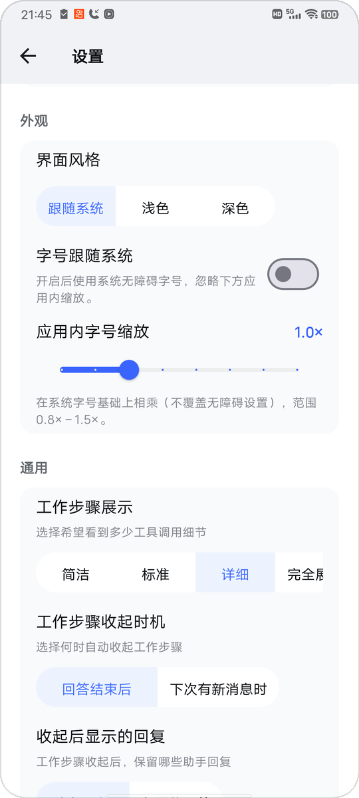

# dsh-Chat

<p align="center">
  <strong>手机上的 DSH 聊天客户端 —— 一套 Flutter 代码，Android / iOS / 鸿蒙。</strong><br>
  连上你自己的 <a href="https://github.com/westanke/dsh-remote-bridge">dsh-remote-bridge</a>，
  对话、会话、工具调用都留在本机。
</p>

<p align="center">
  
</p>

<p align="center">
  <a href="https://gitee.com/westanke/dsh-Chat/releases/tag/v1.0.38"><code>下载 v1.0.38 · APK / HAP</code></a>
</p>

<p align="center">
  <a href="./README.en.md">English</a> ·
  
  
  
  
  <a href="https://github.com/westanke/dsh-Chat/actions/workflows/ci.yml"></a>
</p>

`dsh-Chat` 是 [`dsh-remote-bridge`](https://github.com/westanke/dsh-remote-bridge) 的 Flutter 客户端：
通过 REST `/api/v1` 取会话与历史，通过 WS `/ws/mobile`（子协议 `dsh-mobile-v1`，`hello.protocol=3`）
接收流式增量。本仓**只消费协议**，不改协议；协议的事实来源在 bridge 仓的 `docs/api/`。

**它适合谁**：把 DSH 当主力工具、又不想被“必须坐在电脑前”绑住的人。手机只负责显示和输入，
会话、工作区与文件都留在你自己的机器上；bridge 默认只监听回环地址，不会因为装了客户端就暴露机器。

**边界**：不是任何官方客户端的分支，不连接官方服务器，不复用其图标、字体或二进制资源。
界面尺寸与配色以官方 App 的实测像素为视觉基准（见 [`docs/design-tokens.md`](docs/design-tokens.md)），
但品牌触点（启动页标记、显示名、包名）全部是本工程自己的。

## 实际效果

<p align="center">
  <a href="assets/screenshots/chat.png"></a>
  <a href="assets/screenshots/sessions.png"></a>
  <a href="assets/screenshots/settings.png"></a>
</p>

左：新会话页，工作目录、四张建议卡片与输入条；顶部胶囊点一下能看这一轮的信息与统计。
中：会话抽屉，搜索、日期分组、运行中/待确认/未读筛选，以及「显示已归档」开关。
右：设置页，界面风格、应用内字号缩放与工作步骤展示。三张均为整屏等比缩放，未裁切。

> 截图来自 HarmonyOS 真机（API 26）。Android 与鸿蒙共用同一套 Flutter UI；
> iOS 已补齐原生桥、尚未做真机视觉验收。

## 它能做什么

- **流式对话**：`chat.message.delta` 增量渲染 → `committed` 后重拉历史；外部端（REST）写入也会防抖刷新。
- **Markdown**：标题、嵌套列表、任务列表、代码块（Atom One Light 高亮 + 语言标签 + 复制）、
  表格（官方通栏表头）、引用、行内与块级公式、链接角标，全部按 token 映射。
- **工具调用**：按官方 Web 口径展示 —— 工具行标题三段分派（`运行命令`/`读取`/`编辑`/`搜索文件内容`/
  `网页搜索`/`工具调用 · 名字`…）、摘要取参数关键字段、五态（preparing/running/ok/stopped/failed）
  只进无障碍文案不占行、退出码徽标；展开后按工具类型给专属视图（Bash 等宽命令 + IO 区、
  diff `+N -M` 与行内差异、read 行窗口、search 命中、web 结果、提问卡）。实时帧驱动，不靠防抖重拉。
- **过程组**：连续调用收成一行标题，运行中带实时参数与闪烁；四档展示（简洁/标准/详细/完全展开）
  与收起时机都由设置驱动；轮尾一行 `已完成，用时 X` / `处理失败`。
- **思考流**：呼吸光点环 + 扫光亮标 + 三行高实时窗口；正文开始后收成首行摘要，轮结束自动收起；
  点一下展开全文（Markdown），再点收回。
- **改动与产出**：每轮结束补「改动了 N 个文件」（逐文件 `+N −M`，点开进 diff 页）与
  「生成了 N 个文件」（缩略图 + 类型说明，可复制路径/分享）；数据从工具结果的 `meta.diffs` 本地推导。
- **输入条**：一次可带多张图片（最多 6 张、逐张可删）、`@` 引用工程文件与历史会话
  （会话插 `@[标题](dsh-session:<id>)`）、`/` 斜杠命令；输入条上方常驻任务条；
  **草稿按会话各自保留**，切走再切回来还在（会话归档后自动丢弃）。
- **等待与重试可见**：模型已收到请求但还没输出时，输入区上方三个跳动的点；上游 504/限流触发
  内核自动重试时，消息流里出现可展开的「已重试模型请求（1/5）· 1s」，展开可见延迟与失败原因。
- **连接与重连择优**：局域网 / 虚拟网（Tailscale 等）/ Cloudflare 隧道 / IPv6 直连
  （`http://[<IPv6>]:3090`）都可作候选端点；重连前逐个探活，选最快可用的那个，
  失败原因内联显示。IPv6 全球单播按公网直连处理。
- **设备能力**：本地通知（回答完成/失败/待审批/待回答）、TTS 朗读、系统分享、相册选图、
  打开文件、私有目录；Android 支持 App 内下载更新，iOS / 鸿蒙走 App Store / AppGallery。
- **深色模式、侧边抽屉、失败可见、自动重连**：跟随系统两套色板；抽屉即时搜索 + 日期分组 + 设备账号栏；
  `turn/end` 失败以错误条呈现；退避 1→2→4→8→16s 封顶 30s。

## 支持的平台与当前状态

| 平台 | 现在到哪一步 |
|---|---|
| **Android** | **已真机验证**：配对、自动重连、流式对话、Markdown、工具行五态与详情、过程组四档、思考预览、提问卡、抽屉、深色模式、分享。v1.0.38 APK 26.8 MB |
| **iOS** | 原生桥已补齐 IANA 时区、私有目录、通知、TTS、分享、选图、打开文件；CI 已构建出未签名 IPA。**未在 iPhone 真机验证**；安装/更新走 App Store |
| **HarmonyOS** | **Flutter-OH 版已真机验证**（API 26）：配对、聊天、会话、分享、TTS、选图、通知与点击回跳均通过。正式 release HAP 需 AGC 正式签名 |

当前版本：`app/pubspec.yaml` 为 `1.0.38+39`，tag `v1.0.38`。

未验证的功能不会被写成“已完成”。真机截图是唯一验收证据。

## 下载安装

最新版 **v1.0.38**（Gitee 主站；GitHub 镜像同步同一 tag）：

| 产物 | 大小 | SHA-256 |
|---|---|---|
| [APK](https://gitee.com/westanke/dsh-Chat/releases/download/v1.0.38/dsh-Chat-v1.0.38.apk) | 26,812,418 字节 | `0c7239ad242f4c70bcef9926f808241f5a9e27c05ab1a80bc0d46eb1e01b1f18` |
| [HAP](https://gitee.com/westanke/dsh-Chat/releases/download/v1.0.38/dsh-Chat-v1.0.38-harmony.hap) | 34,716,698 字节 | `17002d782648b9416fc0028e1bc57942d5f8af550cf8dc33df4a24be05aa2166`（本地发布证书签名） |

- Android：直接安装 APK；部分机型会弹风险拦截页，勾选确认后继续。
- HarmonyOS：HAP 需要设备信任的签名。开发机可用 `scripts/sign-hap.sh` 生成 debug 签名包；
  正式分发需 AGC 证书与 Profile。
- iOS：暂不提供 App Store 包；可按下方“从源码构建”在 macOS / GitHub Actions 出未签名 IPA。
- 历史版本与全部 SHA 见 [Gitee Releases](https://gitee.com/westanke/dsh-Chat/releases)
  与 [GitHub Releases](https://github.com/westanke/dsh-Chat/releases)。

> 版本号以 [`app/pubspec.yaml`](app/pubspec.yaml) 的 `version` 为准。

## 第一次使用

1. 在桌面端安装并启用 [`dsh-remote-bridge`](https://github.com/westanke/dsh-remote-bridge)
   （要求 **≥ 2.10.0**，协议 v3），打开「手机设置 → 远程访问」。
2. 手机打开 dsh-Chat，进入「连接到 DSH Bridge」页，填 bridge 地址
   （局域网形如 `http://<主机地址>:3090`，IPv6 写成 `http://[<IPv6>]:3090`；Android 也可用
   `adb reverse tcp:3090 tcp:3090` 后填 `http://127.0.0.1:3090`）。
3. 粘贴桌面端生成的一次性配对码，点「配对并连接」。配对成功后凭证落本地，之后自动重连。

## 远程访问：IPv6 直连（可选）

手机不在家里局域网时，有两条路进 bridge：`dsh-remote-bridge` 自带的 Cloudflare 隧道，
或**家宽 IPv6 直连**。国内家宽 IPv4 多数已是 CGNAT（没有公网 IPv4），但三大运营商普遍
下发 IPv6 前缀；直连不经过第三方，延迟更低。

> 下面这套流程在一台中国移动家宽 + 华为 OptiXstar V175（光猫拨号）上实际打通并验证过，
> 其他省份/型号的菜单见第 2 步的对照表。**只放行 bridge 的 TCP 3090，不要关掉光猫的
> IPv6 防火墙**——关掉等于把光猫下所有设备的所有端口都暴露到公网。

### 1. 确认链路有 IPv6

- 电脑：`ip -6 addr show scope global` 能看到 `2409:` / `2408:` / `240e:` 开头的地址，
  `curl -6 -s https://ifconfig.co` 能回显该地址。
- bridge：监听地址要从默认的 `0.0.0.0` 改成 `::`（Linux 下默认双栈，同时监听 IPv4/IPv6），
  或填电脑的具体 IPv6 地址——`0.0.0.0` 只监听 IPv4。端口仍是 3090。
- 光猫：上网（INTERNET）连接必须是 **IPv4/IPv6 双栈**；部分地区默认只下发 IPv4，要用超管改。
- 手机（蜂窝网、关 Wi-Fi）：访问 `http://[<电脑 IPv6>]:3090`。返回 `401 Unauthorized`
  说明链路已经通，剩下只需配对；超时就回第 2 步查光猫。只放行 TCP 时 `ping6` 不通属正常。

### 2. 光猫放行：只映射一个端口

用**超级管理员**登录光猫（常见 `http://192.168.1.1`），做两件事：

1. 「IPv6 防火墙」保持**启用**；
2. 新增一条 **IPv6 虚拟服务器 / 端口映射**：内部主机填电脑的 IPv6 地址，协议 TCP，
   端口 3090（内外一致），并确认映射挂在 PPPoE 拨号的那条 WAN 上。

光猫的 UPnP 多为 IGD v1，对 IPv6 入站不生效，别指望它自动开端口。

按厂家找菜单（以实际固件为准）：

| 厂家 / 常见型号 | 菜单路径 | 备注 |
|---|---|---|
| 华为 HN8145XR / V173 星光 F30 / OptiXstar V175 | 安全 → 防火墙 → IPv6 防火墙；应用 → 高级 NAT 配置 → IPv6 虚拟服务器设置 | 防火墙保持启用，映射里填主机 IPv6 + TCP + 3090 |
| 中兴 F7607P / G7615 / G7615AV5 | 安全 → 防火墙（IPv6 是独立开关）；应用 → 端口映射 / 虚拟主机 | 部分固件网页没有 IPv6 映射，只能 telnet 用 `ip6tables` 放行（重启还原） |
| 烽火 HG3142f / HG6145D2 | 安全 → 端口过滤 → 接入控制（WAN-LAN） | 用白名单放行目的端口；部分固件端口范围不准且同时影响 IPv4，必须从外网实测 |
| 诺基亚贝尔 / 天邑 TEWA / 友华 | 多数没有独立 IPv6 防火墙开关 | 默认拒绝 IPv6 入站，需 telnet `ip6tables` 放行或请装维处理，重启可能还原 |

### 3. 把电脑的 IPv6 固定下来

光猫的 DHCPv6 默认按地址池顺序分配，系统还会轮换 SLAAC 隐私地址，电脑后缀会漂
（实测出现过 `::2`、`::3`、`::100` 数轮变化），映射目标一变就断线。

- 光猫侧：DHCPv6 静态地址，把电脑网卡 MAC 绑定到固定后缀（如 `::200`）；
- 主机侧（推荐双保险）：再挂一条静态地址，防止光猫重启后 NetworkManager 不再重新申请地址：

  ```sh
  nmcli connection modify "有线连接" +ipv6.addresses '<前缀>::200/64'
  nmcli connection up "有线连接"
  ```

  前缀取光猫下发的 `/64`；`ip -6 addr` 里该地址应带 `forever`。

> 运营商重拨或局端调整后 `/64` 前缀可能整体变化：改光猫映射目标 + 主机静态地址两处，
> 后缀 `::200` 不用动。

### 4. 在 App 里连接

连接页填 `http://[<电脑 IPv6>]:3090`（IPv6 必须带方括号），粘贴桌面端的一次性配对码。
全球单播 IPv6 会被当作直连端点，与局域网 / 虚拟网 / 隧道一起参与重连前的探活择优。

### 光猫账号与口令

- 机壳标签上的 `useradmin` 只有普通权限，改 IPv6 防火墙和端口映射要**超级管理员**。
- 网上常见的出厂超管（各省 / 各固件不同，仅供参考，不保证可用）：

  | 运营商 | 账号 | 常见出厂口令 |
  |---|---|---|
  | 中国移动 | `CMCCAdmin` | `aDm8H%MdA`、`Cmcc10086#` |
  | 中国电信 | `telecomadmin` | `nE7jA%5m` |
  | 中国联通 | `CUAdmin` | `CUAdmin` / `cuadmin` |

  烽火等型号的网页超管账号可能是 `rootadmin`（因型号而异）。
- 运营商 ACS 可能已改掉出厂口令，甚至每次重启都变；机壳标签、装机单才是准的。
  **拿不到超管口令、或改完不生效，请直接联系当地宽带维护人员（装维）**，说明
  「需要从外网访问家里的一个 TCP 端口，请在光猫上做 IPv6 端口映射」，比照网上教程
  改 telnet 安全得多——改错可能断网或恢复出厂设置。
- 本文不记录任何真实 IP、账号或口令。

### 安全提醒

- 只映射 TCP 3090；bridge 未配对时一律返回 401，配对凭证只落在手机本地。
- 不要关闭光猫的 IPv6 防火墙，也不要把电脑设成 DMZ。
- 要求更高时，在前面加一层 HTTPS 反向代理或 VPN（WireGuard / Tailscale），只对外暴露代理端口。

## 从源码构建

需要 Flutter-OH `3.50.0+ohos-1.3.3`、Android SDK、JDK 17；构建鸿蒙包还需要 HarmonyOS SDK API 26。仓库不附带这些 SDK。

```sh
cd app
flutter pub get             # 依赖变更后必跑
flutter analyze             # 提交前必绿
flutter test                # 616 例

flutter build apk --release --target-platform android-arm64
flutter build hap --release --no-codesign   # 鸿蒙 HAP（未签名）
```

- Flutter 必须用 **Flutter-OH**。上游 stable 没有 `TargetPlatform.ohos`，
  material_ui/cupertino_ui 的 ohos fork 编不过。
- iOS 在 macOS 上：`flutter build ios --release --no-codesign`，再把 `Runner.app/Payload`
  压成未签名 IPA；CI 的 `macos-15` job 已走通。

## CI 与发布

| 工作流 | 内容 |
|---|---|
| [`ci.yml`](.github/workflows/ci.yml) | `docs-check` + `flutter analyze` + `flutter test`（616 例）；用 Flutter-OH SDK |
| [`release.yml`](.github/workflows/release.yml) | tag 触发：Ubuntu 出 APK、`macos-15` 出未签名 IPA；HAP 为可选 self-hosted job（需 `BUILD_HAP=true` 与真实鸿蒙 SDK） |
| [`mirror-sync.yml`](.github/workflows/mirror-sync.yml) | Gitee → GitHub 镜像同步；GitHub 是从站，日常推送目标是 Gitee |

本仓发版以 Gitee 为主站：`scripts/release.sh` 负责门禁、APK/HAP 构建、可选签名、README 回填、
双站 Release 与附件回读；细节见 [`docs/project/RELEASE.md`](docs/project/RELEASE.md)。

## 仓库结构

```
dsh-Chat/
  AGENTS.md     ← 工程宪法：红线、命令、token 与协议纪律、文档同步表、坑位索引
  assets/       ← README hero 图与实际效果截图
  screenshots.json ← README/市场截图清单
  docs/         ← STRUCTURE.md（文件清单）/ design-tokens.md（设计基准）/ project/（文档索引）
  ref/          ← 官方界面基准截图、样式表与抓包记录，只读，不参与构建、不被 app/ 引用
  app/          ← Flutter 工程根（lib/ 下仅 design/、bridge/、ui/ 三个子目录）
  app/ohos/     ← Flutter-OH 鸿蒙宿主工程（bundleName com.dsh.dshchat）
  app/vendor/   ← 本仓打补丁的第三方包（gpt_markdown，见其 README.dsh.md）
  LICENSE       ← AGPL-3.0 全文
```

`app/lib/` 的逐个文件职责见 [`docs/STRUCTURE.md`](docs/STRUCTURE.md)。

## 文档

| 文件 | 记的是 |
|---|---|
| [`AGENTS.md`](AGENTS.md) | 工程宪法，改任何东西之前先读 |
| [`docs/STRUCTURE.md`](docs/STRUCTURE.md) | 目录与文件清单、协议引用、踩过的协议坑 |
| [`docs/design-tokens.md`](docs/design-tokens.md) | 颜色/字号/间距的唯一事实来源 |
| [`docs/project/README.md`](docs/project/README.md) | 项目文档索引与待建清单 |
| [`docs/project/RELEASE.md`](docs/project/RELEASE.md) | 三端构建、签名、发布与回读流程 |
| [`docs/终版对比-官方vs本工程.png`](docs/终版对比-官方vs本工程.png) | 终版并排对照图 |

## 已知限制

- **iOS 未真机验收**：原生桥已实现、CI 构建通过，但通知点击、TTS 音质、相册/文件权限等仍需
  iPhone 实机确认；iOS 不允许 App 内安装，更新只提示 App Store。
- **鸿蒙正式签名**：release HAP 用发布证书签名时，部分设备会报
  `signature verification failed due to not trusted app source`；正式分发需 AGC 证书/Profile。
- **应用名**：v1.0.36 及更早的 HAP 桌面名仍是 `dshchat`；v1.0.37 起已改为 `DSH Chat`。
- **工具链锁定**：三端共用 Flutter-OH SDK；不要用上游 stable 替换，否则 ohos fork 依赖编译失败。
- **更新方式**：只有 Android 支持 App 内下载安装；iOS / 鸿蒙走各自应用商店。

## 仓库地址

| 站点 | 地址 | 说明 |
|---|---|---|
| Gitee | <https://gitee.com/westanke/dsh-Chat> | 主站 |
| AtomGit | <https://atomgit.com/westanke163/dsh-Chat> | 备站 |
| GitHub | <https://github.com/westanke/dsh-Chat> | 自动镜像从站，不手工推送 |

## 姊妹仓库

- [`dsh-remote-bridge`](https://github.com/westanke/dsh-remote-bridge) —— 本仓的上游，桌面端插件
  （REST + WS + 手机设置面板）；协议与最低版本要求以它为准（当前要求 ≥ 2.10.0 / 协议 v3）。
- [`dsh-companion`](https://github.com/westanke/dsh-companion) —— 同生态的 Kotlin/Compose 客户端，
  与本仓共用同一套 bridge 协议；**已停止维护更新**，仅作历史参考。

## 许可证

[GNU Affero General Public License v3.0](LICENSE)。
